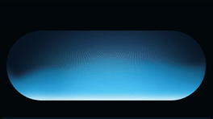

# 高仿 Gemini 语音光效

> 一个纯前端 Canvas 复刻的「Gemini 语音光效」：横向胶囊灯 + 底部液态 metaball 光晕 + 随光起伏的三角点阵，并可接入麦克风做实时响应。



整个效果只用 `HTML + CSS + 原生 JavaScript (Canvas 2D)` 实现，**零依赖、零构建**，双击打开 `capsule_light_triangular_dot_matrix.html` 即可运行。

---

## 效果与交互

- **横向胶囊灯**：居中的圆角胶囊（stadium / pill）作为光效容器。
- **液态光晕**：底部一池会呼吸、会流动的液态光，像极光一样在胶囊里涌动。
- **三角点阵**：六边形错排的细密光点，会被下方的光「顶」起来，越靠近光越亮、越稀疏，形成起伏的波浪。
- **三套配色**：Cyan 青、Violet 紫、Emerald 翠，风格与 Gemini 接近。
- **麦克风实时驱动**：开启麦克风后，说话的音量会实时加快光效流动、提高亮度，并带一点惯性延迟。

## 快速开始

```bash
# 方式一：直接打开（麦克风可能受浏览器安全策略限制）
#   双击 capsule_light_triangular_dot_matrix.html

# 方式二（推荐）：起一个本地静态服务器，麦克风在 http://localhost 下可用
python3 -m http.server 8000
# 然后浏览器访问 http://localhost:8000/capsule_light_triangular_dot_matrix.html
```

> 说明：`navigator.mediaDevices.getUserMedia` 需要安全上下文（`https` 或 `localhost`）。
> 直接用 `file://` 打开时，部分浏览器会禁用麦克风，此时光效仍可正常自动播放，只是无法用声音驱动。

## 控件

| 控件 | 范围 / 取值 | 说明 |
| --- | --- | --- |
| **Speed** | 0 – 3x | 光效流动与点阵脉冲的整体速度 |
| **Glow** | 0 – 100% | 光晕强度，同时影响光对点阵的推力 |
| **Mask** | 0 – 2x | 光对点阵的「挖空」遮罩力度，光越强该处的点越淡 |
| **Dot Size** | 0.5 – 4px | 点阵单个光点的半径 |
| **Spacing** | 8 – 40px | 三角点阵的网格间距（实时重建网格） |
| **Theme** | Cyan / Violet / Emerald | 切换整套配色预设 |
| **Playback** | Pause / Play | 暂停或继续动画 |
| **Mic** | Enable Mic | 申请麦克风权限并开启实时响应 |

---

## 实现细节

### 1. 四层离屏 Canvas 架构

主画面并不是直接画出来的，而是拆成 4 张 canvas 叠加，各司其职：

| Canvas | 作用 |
| --- | --- |
| `metaballCanvas` | 画各个光球的径向渐变，做「元球（metaball）」融合 |
| `lightCanvas` | 对元球层做高斯模糊，并叠加液态波体 |
| `dotCanvas` | 单独渲染三角点阵，便于整体做一次轻微模糊 |
| `mainCanvas` | 最终合成：背景 + 光层 + 点阵层，并统一裁剪到胶囊内 |

全部按 `devicePixelRatio` 缩放，保证高分屏下不糊。

### 2. 胶囊几何与「下轮廓」函数

胶囊用标准 stadium 路径（矩形 + 两端半圆）绘制。关键函数 `capsuleLowerEdgeY(x)` 返回胶囊**下边缘**在任意 `x` 处的 `y`：中间是水平底边，靠近两端则沿半圆弧向上弯。
光球和液态波体的底边都让它们「骑」在这条轮廓上，所以两端的运动会自然沿弧线上扬，而不是一条直线穿过圆角。

### 3. 元球液态光：加性混合 + 平滑钟形衰减

- 用 `globalCompositeOperation = 'lighter'`（加性混合）把多个光球叠在一起：相邻光球的衰减会**相加**而不是互相覆盖，缝隙处依然明亮，从而「焊接」成一整团连续的液体，而不是五个独立光斑。
- 每个光球用径向渐变，**采样 30 档色标**逼近一条平滑钟形曲线（`exp(-3t²)·(1-t²)`），而不是几档硬色标——硬色标会在叠加时形成同心圆环、暴露出单个光球的边界。平滑采样让值与其斜率都连续，融合处无缝。
- 颜色从中心的白热（`240,249,255`）逐渐过渡到光球本色，避免高模糊下出现浑浊或发紫。

### 4. `bottomPad`：消灭底部透明带

高斯模糊的卷积核需要采样周围像素。如果画布刚好在底边结束，模糊核会采样到画布外的透明区域，导致底部出现一条变淡/透明的带子。
解决办法是给元球层额外预留 `bottomPad = 260px` 的高度，让光球下半部分画在视口之外的真实像素上，模糊永远有内容可采样，底部亮度才均匀。最后用胶囊路径裁剪掉多余部分。

### 5. 液态波体

除了光球，还有一层单路径的「液体」：

- 波峰由每个光球的水平影响范围叠加而成（余弦衰减 + `factor^1.3` 加权），再叠一个 `sin` 行波制造流动感。
- 波体底边同样跟随 `capsuleLowerEdgeY(x)`，并整体下移 `wavePad = 70px`，保证 30px 模糊下方始终有实心像素。
- 用一条从底到顶的多段线性渐变填充：底部接近白、往上依次过渡到主色、副色、透明，让光在圆角处自然变暗、向两端淡出。

### 6. 三角（六边形错排）点阵

- 行高取 `spacing * √3 / 2`，相邻行水平错开半个间距，得到等边三角形网格。
- 网格铺满胶囊的包围盒，绘制时用胶囊裁剪路径裁掉圆角外的点。
- 底部额外多生成若干行，防止点被向上顶起后露出空隙。

### 7. 光驱动点阵位移（不交叉）

点阵的位移是「光场驱动」的：

1. 每帧沿胶囊底边采样一次光的水平强度，得到一维 `pushField`；再按列对点阵施加一个向上的「柱状推力」。
2. 叠加一个随高度衰减的局部推力，使下层点被顶得更多、上层更少，形成中间密、两边疏的压缩感。
3. 每个点用弹性插值 `y += (targetY - y) * 0.12` 平滑逼近目标位置，运动有阻尼感。
4. **点只沿竖直方向（`x = baseX`）移动**，严格不改变列坐标，从根本上杜绝网格交叉/重叠，同时保持六边形对齐。

### 8. 光对点的「挖空」与边缘淡出

- 越亮的地方，点越淡：`finalOpacity *= (1 - lightCutout * 0.85 * maskDepth)`，`Mask` 滑杆控制 `lightCutout` 强度。这样光晕之上不会糊一层点，保留通透感。
- 底部三分之一做淡入渐变，底部（最贴近光的地方）透明度从 0 逐渐升到 1，避免生硬。
- 左右两端用 `sin(π·nx)` 让点阵完全溶解到透明，与光的边缘淡出对齐。

### 9. 麦克风实时响应（带惯性）

- 用 `AnalyserNode`（`fftSize = 64`）取频谱均值作为音量，映射到 `0–1`。
- 用指数阻尼 `smoothedVolume += (target - smoothedVolume) * 0.18` 做平滑，制造「跟手但有一点滞后」的有机感，而不是突兀跳变。
- 音量同时加成速度（最多 +2.6x）与亮度（最多 +1.4x）。

### 10. 配色预设

三套调色板都统一为「白热核心 + 同色系光球 + 浅色点阵」，保证在高模糊下依旧干净：

- **Cyan**：天青 / 深青 / 海蓝 / 水绿 / 浅青
- **Violet**：紫罗兰 / 品红 / 靛蓝 / 紫红 / 浅紫
- **Emerald**：翠绿 / 青蓝 / 海蓝 / 蓝绿 / 浅翠绿

---

## 目录结构

```
gemini-voice-light/
├── capsule_light_triangular_dot_matrix.html   # 全部实现（HTML + CSS + JS）
├── demo.gif                                    # 效果演示
├── README.md
└── .gitignore
```

## 技术栈

- 原生 **Canvas 2D**（`createRadialGradient` / `globalCompositeOperation` / `filter: blur` / `clip`）
- **Web Audio API**（`AudioContext` + `AnalyserNode`）
- 无框架、无依赖、无构建步骤

## 浏览器兼容

- 现代 Chrome / Edge / Firefox / Safari 均可运行。
- 麦克风需要 `https` 或 `localhost` 安全上下文。
